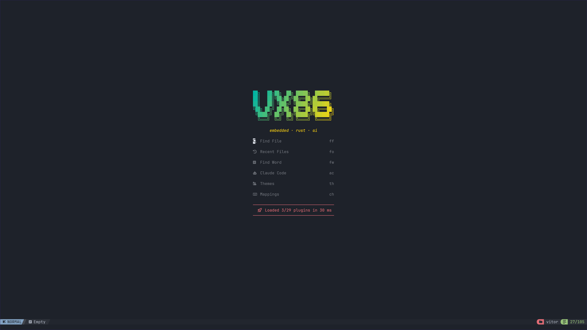

<div align="center">

# vx86 · neovim

**My personal Neovim setup, tuned for embedded systems, Rust, and AI-assisted coding.**

[](https://neovim.io)
[](https://github.com/NvChad/NvChad)
[](https://www.lua.org)
[](https://github.com/coder/claudecode.nvim)
[](LICENSE)



</div>

---

## Contents

- [Why this setup](#why-this-setup)
- [Features](#features)
- [Requirements](#requirements)
- [Installation](#installation)
- [First steps](#first-steps)
- [Essential keymaps](#essential-keymaps)
- [AI workflow with Claude Code](#ai-workflow-with-claude-code)
- [Project structure](#project-structure)
- [Customization](#customization)
- [Updating](#updating)
- [Troubleshooting](#troubleshooting)
- [Roadmap](#roadmap)
- [Documentation](#documentation)
- [Credits](#credits)

## Why this setup

I want an editor that starts instantly, stays out of the way, and covers my daily work:

- **Embedded systems**: C/C++, cross-compiling, serial monitors, debugging on hardware.
- **Rust**: from small CLI tools to `no_std` firmware.
- **AI**: an assistant built into the editor, able to read my code and propose diffs I can review.

The base is [NvChad](https://github.com/NvChad/NvChad), used through its official [starter config](https://github.com/NvChad/starter). NvChad has a polished UI and lazy-loads almost everything, so startup takes about **30 ms**. Everything I add lives in this repo, on top of NvChad.

## Features

| | |
|---|---|
| ⚡ **Fast startup** | Plugins lazy-load with [lazy.nvim](https://github.com/folke/lazy.nvim); only 3 of 29 load at startup |
| 🤖 **Claude Code** | Chat, share files or selections, and accept or reject AI diffs without leaving Neovim |
| 🎨 **Custom dashboard** | VX86 logo with a teal-to-yellow gradient and quick-action buttons |
| 🔭 **Fuzzy finding** | Telescope for files, text, buffers, git commits, and git status |
| 🧠 **LSP and completion** | nvim-lspconfig + Mason + nvim-cmp + LuaSnip with friendly-snippets |
| 🌳 **Treesitter** | Accurate syntax highlighting and indentation |
| 🗂️ **File tree** | nvim-tree with git status and icons |
| 🖥️ **Terminals** | Horizontal, vertical, and floating terminals with one key |
| 🌈 **Themes** | Dozens of base46 themes, switchable live with `<space>th` |
| 📦 **One-command install** | `install.sh` sets up dependencies, plugins, and language servers |

## Requirements

| Requirement | Why |
|---|---|
| **Neovim ≥ 0.11** | NvChad v2.5 uses the new `vim.lsp.config` API |
| **Arch / Manjaro** | `install.sh` uses `pacman` (on other distros, install the packages by hand) |
| **A Nerd Font** | Icons; the script installs JetBrainsMono Nerd Font |
| `git`, `gcc`, `make` | Plugin installs and Treesitter parser builds |
| `ripgrep` | Telescope live grep |
| `nodejs`, `npm`, `unzip` | Some Mason language servers |
| `xclip` / `wl-clipboard` | System clipboard on X11 / Wayland |
| [`claude`](https://claude.com/claude-code) CLI | AI features (optional) |

## Installation

### Automatic (recommended)

```bash
git clone git@github.com:vitorecomp/neovim-ricing.git ~/workspace/personal/neovim-ricing
cd ~/workspace/personal/neovim-ricing
./install.sh
```

The script:

1. Installs the system packages above with `pacman` (asks for your sudo password).
2. Backs up any existing `~/.config/nvim` to `~/.config/nvim.bak.<timestamp>`.
3. Symlinks `~/.config/nvim` to this repo, so edits here take effect right away.
4. Installs every plugin headlessly (`:Lazy! sync`).
5. Installs the language servers (`:MasonInstallAll`).

It is safe to run again.

### Manual

```bash
sudo pacman -S --needed git gcc make ripgrep nodejs npm unzip xclip ttf-jetbrains-mono-nerd
ln -s "$PWD" ~/.config/nvim
nvim   # lazy.nvim bootstraps itself and installs the plugins on first launch
```

Then, inside Neovim, run `:MasonInstallAll`.

## First steps

1. Set your terminal font to **JetBrainsMono Nerd Font**.
2. Open `nvim`. You'll see the dashboard.
3. Press `<space>th` and pick a theme.
4. Press `<space>ch` to open the cheatsheet with every mapping.
5. Run `:checkhealth` once to confirm everything is green.

> **Tip:** `<leader>` is **Space**. Press it and wait: [which-key](https://github.com/folke/which-key.nvim) shows every available follow-up key.

## Essential keymaps

The most used keys. The full list is in **[docs/fast-commands.md](docs/fast-commands.md)**.

| Key | Action | | Key | Action |
|---|---|---|---|---|
| `<space>ff` | Find files | | `<C-n>` | Toggle file tree |
| `<space>fw` | Search text in project | | `<space>e` | Focus file tree |
| `<space>fb` | Open buffers | | `<Tab>` / `<S-Tab>` | Next / previous buffer |
| `<space>fo` | Recent files | | `<space>x` | Close buffer |
| `gd` | Go to definition | | `<A-i>` | Floating terminal |
| `K` | Hover docs | | `<A-h>` / `<A-v>` | Horizontal / vertical terminal |
| `<space>ra` | Rename symbol | | `<space>/` | Toggle comment |
| `<space>fm` | Format file | | `<C-s>` | Save |
| `<space>ac` | Toggle Claude | | `;` | Command mode |

## AI workflow with Claude Code

[claudecode.nvim](https://github.com/coder/claudecode.nvim) runs the [Claude Code](https://claude.com/claude-code) CLI in a split. Neovim exposes your open files, selections, and diagnostics to it over a local WebSocket, so Claude sees what you see.

A typical loop:

1. `<space>ac` opens Claude next to your code.
2. Select a block in visual mode and press `<space>as` to send it, or `<space>ab` to add the whole file.
3. Ask for a change. Claude opens it as a **native Neovim diff**.
4. Review it, then `<space>aa` to accept or `<space>ad` to reject.

| Key | Action |
|---|---|
| `<space>ac` | Toggle the Claude terminal |
| `<space>af` | Focus Claude |
| `<space>ar` / `<space>aC` | Resume / continue a previous session |
| `<space>am` | Select a model |
| `<space>ab` | Add the current buffer to Claude's context |
| `<space>as` | Send the visual selection (or the file under the cursor in nvim-tree) |
| `<space>aa` / `<space>ad` | Accept / reject a diff proposed by Claude |

## Project structure

```
.
├── init.lua                  # Bootstraps lazy.nvim and loads NvChad
├── install.sh                # One-command setup for Arch/Manjaro
├── lazy-lock.json            # Pinned plugin versions
├── CLAUDE.md                 # Rules for AI agents working on this repo
├── docs/
│   ├── plugins.md            # Every installed plugin and what it does
│   ├── fast-commands.md      # Keymap / command reference
│   └── images/               # README screenshots
└── lua/
    ├── chadrc.lua            # NvChad options: theme, dashboard, UI
    ├── options.lua           # Vim options
    ├── mappings.lua          # Custom keymaps
    ├── autocmds.lua          # Autocommands
    ├── configs/
    │   ├── lazy.lua          # lazy.nvim settings
    │   ├── lspconfig.lua     # Language servers to enable
    │   └── conform.lua       # Formatters per filetype
    ├── plugins/
    │   ├── init.lua          # Plugin overrides (conform, lspconfig)
    │   └── claudecode.lua    # Claude Code integration
    └── vx86/
        └── dashboard.lua     # Gradient logo and start-screen buttons
```

## Customization

<details>
<summary><b>Change the theme</b></summary>

Press `<space>th` to preview and pick one live. The choice is saved to `lua/chadrc.lua`:

```lua
M.base46 = { theme = "onedark" }
```
</details>

<details>
<summary><b>Change the dashboard logo or colors</b></summary>

Edit `lua/vx86/dashboard.lua`:

```lua
M.logo = { ... }      -- the ASCII art lines
M.from = "#00b3a4"    -- gradient start (teal)
M.to   = "#ffd60a"    -- gradient end (yellow)
```

Tools like [patorjk.com/software/taag](https://patorjk.com/software/taag/) ("ANSI Shadow" font) generate new logos.
</details>

<details>
<summary><b>Add a plugin</b></summary>

Create `lua/plugins/<name>.lua` returning a [lazy.nvim spec](https://lazy.folke.io/spec). Every file in that folder is loaded automatically:

```lua
return {
  "author/plugin.nvim",
  event = "VeryLazy",
  opts = {},
}
```

Then update `docs/plugins.md` and `docs/fast-commands.md` (see [CLAUDE.md](CLAUDE.md)) and commit `lazy-lock.json`.
</details>

<details>
<summary><b>Add a language server</b></summary>

1. Install it: `:MasonInstall <server>` (or with your system package manager).
2. Enable it in `lua/configs/lspconfig.lua`:

```lua
local servers = { "html", "cssls", "clangd", "rust_analyzer" }
vim.lsp.enable(servers)
```
</details>

<details>
<summary><b>Format on save</b></summary>

Uncomment `format_on_save` in `lua/configs/conform.lua` and `event = "BufWritePre"` in `lua/plugins/init.lua`, then add formatters under `formatters_by_ft`.
</details>

## Updating

```bash
# Starter-config changes from NvChad
git fetch upstream && git merge upstream/main
```

Inside Neovim:

| Command | Updates |
|---|---|
| `:Lazy sync` | All plugins, including NvChad itself |
| `:MasonUpdate` | Mason registry |
| `:TSUpdate` | Treesitter parsers |

Commit `lazy-lock.json` after updating, so other machines get the same versions.

## Troubleshooting

| Problem | Fix |
|---|---|
| Icons are squares or `?` | Set the terminal font to a Nerd Font (v3+) |
| Copy/paste doesn't reach the system clipboard | Install `xclip` (X11) or `wl-clipboard` (Wayland) |
| Treesitter errors on startup | Make sure `gcc` is installed, then `:TSUpdate` |
| A language server doesn't attach | `:checkhealth vim.lsp`, then `:Mason` to check it's installed |
| `:ClaudeCode` does nothing | Check `claude --version` works in your shell, then `:ClaudeCodeStatus` |
| Something else is broken | `:checkhealth`, and `:Lazy` to see plugin errors |

## Roadmap

- [x] NvChad base with lazy-loading
- [x] Claude Code integration
- [x] Custom VX86 dashboard
- [x] One-command installer
- [ ] **Rust**: rust-analyzer, [rustaceanvim](https://github.com/mrcjkb/rustaceanvim), [crates.nvim](https://github.com/saecki/crates.nvim)
- [ ] **Embedded C/C++**: clangd with `compile_commands.json`, CMake integration
- [ ] **Debugging**: [nvim-dap](https://github.com/mfussenegger/nvim-dap) with probe-rs / OpenOCD / GDB
- [ ] **Hardware workflow**: serial monitor, flash-and-run tasks
- [ ] Format on save for Rust, C, and Lua

## Documentation

| File | Content |
|---|---|
| [docs/plugins.md](docs/plugins.md) | Every installed plugin, what it does, and where it's configured |
| [docs/fast-commands.md](docs/fast-commands.md) | All keymaps and commands, grouped by plugin |
| [CLAUDE.md](CLAUDE.md) | Conventions for AI agents editing this repo |

## Credits

- [NvChad](https://github.com/NvChad/NvChad) and its [starter](https://github.com/NvChad/starter): the foundation of this config
- [coder/claudecode.nvim](https://github.com/coder/claudecode.nvim): Claude Code integration
- [folke/lazy.nvim](https://github.com/folke/lazy.nvim): plugin management
- Every plugin author listed in [docs/plugins.md](docs/plugins.md)

Released under [the Unlicense](LICENSE).
